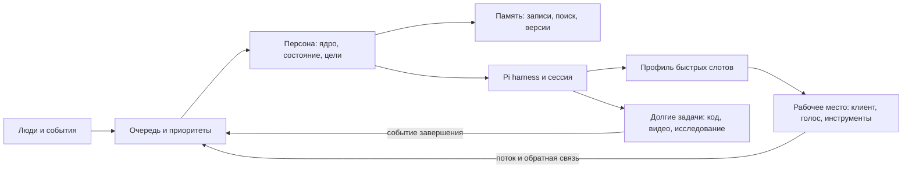

# Техническое задание: UberPersona

## Цель

Не набор жёстко заданных игровых скриптов, а рабочая среда, в которой персонаж живёт, общается, играет, исследует, пишет код и создаёт видео. Целевой синхронный диалог: первое звучащее слово за 1–3 секунды после завершения реплики собеседника. Сегодняшние примерно 30 секунд — наблюдение владельца, требующее измерения на конкретном сценарии, а не гарантированная характеристика каждой системы.

## Что уже есть и что меняем

MineSwarm: контейнеры инструментов и игровые клиенты, gateway, цикл с событиями, OpenCode и плагины. По документации `docs/dev/agents.md`, актуальный выбранный мозг может работать вне контейнера через PAC, а OpenCode внутри — руки/запасной мозг. Точное состояние перед экспериментом проверять фактически, не выдавать документацию за живой статус. Личность разделена между относительно неизменяемыми PERSONA/ROMANCE и меняющимися memory/state, отношениями и целями; есть связанные Markdown-файлы и семантический индекс. Сейчас границы и переносимость связаны с файловыми и runtime-правилами; не считать произвольную запись в память изменением ядра личности.

PAC: персона, рабочее пространство, сессия и мозг — отдельные сущности. Тяжёлые приложения, Minecraft-клиент и инструменты принадлежат рабочему месту; персона может сменить место, не переписывая себя. Транспорт «мозг — руки» не делает файловые системы и временные каталоги общими. Использовать договор ресурсов и занятости, а не копировать приватные данные комплекса.

Цель: Pi harness в контейнере. Сначала проверить расширения и публичные API, динамические инструменты, события, потоковую генерацию и управление сессией на зафиксированной версии. Предпочтителен внешний пакет расширений; форк разрешён только при документированном доказательстве, что требование нельзя выполнить иначе, с планом обновлений и тестами совместимости. OpenCode и PAC остаются отдельными исходными примерами, а не автоматически заменяемым production-контуром.

## Личность и память

Неизменяемое ядро — характер, ценности и границы, меняется только через явную процедуру владельца; изменяемое состояние — настроение, привычки, цели, отношения и опыт, с историей, источниками и возможностью исправления. Дать персонажу непрерывность через смену сессий и мест. Память — отдельный заменяемый слой, не считать Obsidian лучшим решением по умолчанию; провести сравнительный эксперимент согласно RESEARCH.md. Изоляция персон, временные факты, исправления и удаление должны быть проверяемыми. Не раскрывать приватную память в публичных отчётах.

## Быстрые действия и профили

Персона сама готовит, проверяет, активирует и меняет набор слотов под ситуацию; число слотов настраивается, а не зашивается в продукт. Примеры: BedWars; диалог в Контур.Толке; Telegram; голосовой чат Minecraft. Слот — декларация входа, среды, назначения, обработчика, границ, версии и способа отката. Быстрый маршрут может направлять поток текста агента прямо в потоковый TTS и заранее подключённый аудиовыход; агент выбирает и переназначает маршрут на ходу. При смене среды профиль переключается и восстанавливается. Выбор слота не должен требовать написания скрипта на каждую реплику.

События доставляются push там, где доступен, в частности сообщения, прерывания, окончание задачи и состояние транспорта; polling остаётся совместимым fallback. Приоритет адресованной речи выше фонового наблюдения. Нужны очереди, ограничение объёма, дедупликация, отмена устаревших действий и восстановление после разрыва. Не ожидать полного окончания долгой кодовой задачи для начала ответа.

Горячий поток речи и заранее разрешённые типизированные операции не должны запускать повторные тяжёлые проверки на каждый токен. Разрешения и границы задаются при подключении профиля; произвольный код, изменения профиля и внешние побочные действия проходят отдельную проверку до активации. Проверять возможность немедленного прерывания и отмены очереди озвучки; не путать быстрый путь с неограниченным выполнением произвольных команд.

## Испытания

Измерять монотонным временем: конец человеческой реплики → финал STT → поступление события → первый токен → первая аудиочасть → реально слышимое первое слово у второго участника. Для каждого сценария: 30+ диалогов, медиана/p95, доля успешных ответов в 1–3 секунды, ошибки, прерывания, нагрузка и стоимость; отдельно холодный старт, тёплый путь, одновременная долгая задача и смена профиля. Фиксировать конфигурации, условия и реальные данные, не выдавать ASR или поставленные аудиофайлы за живой разговор. Проверить непрерывность личности, извлечение и исправление памяти, переключение Minecraft/звонка, отказы сервиса, переподключение, безопасность профилей и отсутствие утечек между персонами.

## Этапы

1. Прочитать исходники, получить точную карту работающих процессов и зависимостей; не вмешиваться в действующих агентов.
2. Исследовать доступные технологии и выполнить воспроизводимое сравнение памяти и Pi API; сохранить критерии, источники, версии и результаты.
3. Собрать изолированный прототип Pi + профиль слотов + события + потоковое TTS; сначала без изменений исходников Pi.
4. Подключить сменные рабочие места и долговременную память; продемонстрировать смену сред и самоизменение слота с откатом.
5. Провести живые испытания, получить артефакты измерений и видеоотчёт. Никаких заявлений о 1–3 секундах без реального измерения.
